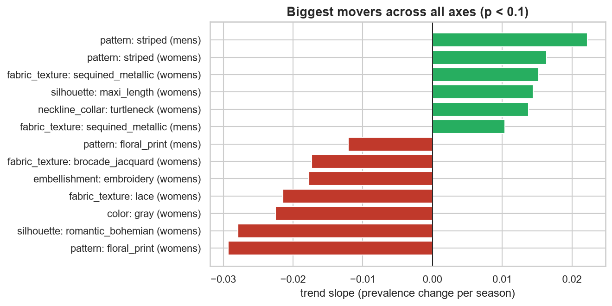

# Runway Radar 🐍✨

**[Live demo →](https://runway-radar.streamlit.app/)** *(hosted on Streamlit Community Cloud's free tier — the app sleeps after inactivity, so the first load may take ~30 seconds to wake up)*

A trend-analysis tool that treats one designer's runway history as a time
series: **Gucci under Alessandro Michele, Fall 2015 – Spring 2023**. It detects
visual attributes (silhouette, neckline/collar, fabric, pattern, embellishment,
color) in 486 runway looks across 16 seasons, tracks how each attribute rises
and fades, and serves the results through an interactive dashboard and a
REST API. It follows the spirit of commercial trend-forecasting tools such as
Heuritech or Stylumia, at the scale of a solo project.



## What's in the project

| Part | What it does | Tech |
|---|---|---|
| **Vision pipeline** | Zero-shot attribute detection per look, with per-label calibration; dominant color via k-means | CLIP (open_clip, ViT-B-32), PyTorch, scikit-learn |
| **Trend analysis** | Per-season attribute prevalence and simple linear trend fits | pandas, SciPy |
| **Dashboard** | Trends, biggest movers, season gallery, methodology | Streamlit, Plotly |
| **REST API** | Serves seasons, trends and prevalence with validated filters | FastAPI, Pydantic, SQLite |
| **Quality** | Automated tests, CI on every pull request, containerized API | pytest, GitHub Actions, Docker |

## Methodology (summary)

1. **Data**: runway look images collected manually from Gucci's own official
   show archive / official channels — not scraped, not bulk-automated.
2. **Attribute extraction**: CLIP zero-shot classification against a curated
   prompt vocabulary per attribute axis (prompt ensembling, plus a per-label
   baseline correction for CLIP's tendency to favor certain labels). Color is
   extracted separately with k-means, since CLIP is weak at color naming.
3. **Validation**: predictions were compared with an independent blind
   hand-labeling of a 48-look sample:

   | Axis | Agreement | vs. random chance |
   |---|---|---|
   | pattern | 60.9% | 4.9x |
   | fabric_texture | 40.4% | 3.2x |
   | silhouette | 37.5% | 3.0x |
   | neckline_collar | 29.8% | 2.1x |
   | embellishment | 27.9% | 2.0x |

4. **Trend aggregation**: per-season prevalence of each label, summarized
   with simple, interpretable linear trend fits — explicitly *not*
   deep-learning forecasting, since there are only 16 seasons of data. Any
   "next season" projection is framed as trend extrapolation, not prediction.

Full validation notes: `src/runway_radar/validation/labeling_notes.md`.

### Known limitations

- Agreement figures are per-image accuracy, not a direct measure of
  season-level trend accuracy. Aggregating many looks per season tends to
  average out unsystematic noise, but this is not separately validated.
- Each trend line is fit on 16 points, so a relaxed significance threshold
  (p < 0.1) is used and results are labeled tentative where they don't clear it.
- Embellishment is the weakest axis (27.9% agreement), so its trends should be
  read with extra caution.
- Two seasons (Spring 2021, Fall 2021) were presented as short films rather
  than traditional runway shows.

## Getting started

Requires [uv](https://docs.astral.sh/uv/) and Python 3.12.

```bash
uv sync
```

**Dashboard**

```bash
uv run streamlit run src/runway_radar/app/streamlit_app.py
```

**API** — build the database from the committed CSVs, then start the server:

```bash
uv run python -m runway_radar.api.load_db
uv run fastapi dev src/runway_radar/api/main.py
```

Interactive documentation is then available at http://127.0.0.1:8000/docs.

**Tests**

```bash
uv run pytest
```

**Docker** (API only)

```bash
docker build -t runway-radar-api .
docker run --rm -p 8000:8000 runway-radar-api
```

The image is currently about 2.2 GB because the ML dependencies are still
installed alongside the API; splitting them is planned.

## API

| Endpoint | Description | Optional filters |
|---|---|---|
| `GET /health` | Liveness check | — |
| `GET /seasons` | The 16 seasons, in order | — |
| `GET /trends` | Trend fit per label (slope, p-value, direction, projection) | `axis`, `line` |
| `GET /prevalence` | Per-season prevalence of each label, ordered by season | `season_index`, `line`, `axis`, `label` |

`axis` is one of `silhouette`, `neckline_collar`, `fabric_texture`, `pattern`,
`embellishment`, `color`; `line` is `mens` or `womens`. Invalid values return
`422`. All queries are parameterized.

```bash
curl "http://127.0.0.1:8000/prevalence?axis=pattern&line=mens&label=floral_print"
```

## Legal & sourcing notes

- **Primary source**: Gucci's own official YouTube channel (`@gucci`) —
  individual looks are manually screenshotted while watching the full show
  video at normal playback. No automated bulk scraping, no downloading or
  ripping of the video files themselves.
- **Fallback source**: when the official channel's video quality is
  genuinely too low to resolve garment detail (this happened for the Fall
  2015 menswear show), a small number of individual stills are instead
  manually screenshotted from third-party editorial coverage (e.g. WWD
  runway galleries). These are used strictly as **private, local-only
  reference material** — never committed to this repository, never
  redistributed, and not treated as the project's default sourcing method.
  Every image's actual origin (YouTube vs. editorial gallery) is recorded
  per-row in `data/metadata/looks.csv` for full provenance.
- Raw image files live only in `data/raw/` (git-ignored) and are **never**
  committed or redistributed under either sourcing method. This repo ships
  code, extracted attribute metadata, and aggregated statistics — not the
  source photography.
- The dashboard displays derived visualizations (attribute tags, color
  swatches, charts) rather than raw copyrighted images wherever practical.
- This is a personal, non-commercial, educational/portfolio project.

## Project layout

```
data/
  raw/         # collected images (git-ignored)
  metadata/    # season/year/source CSV (committed)
  processed/   # extracted attributes + aggregated time series (committed)
src/runway_radar/
  acquisition/ # helpers to register manually-collected images
  attributes/  # CLIP zero-shot extractor, color palette, prompt vocab
  aggregation/ # per-season stats, trend fits, static charts
  validation/  # hand-label set + agreement notes
  app/         # Streamlit dashboard
  api/         # FastAPI service + SQLite loader
tests/         # API tests (pytest)
reports/       # generated figures
.github/       # CI workflow (GitHub Actions)
Dockerfile     # container image for the API
```
